<!-- 00game -->

# RNN Review Game

## In what Situation would you use an RNN?

a.  When we want to make predictions about a sequence
b.  When we want to make predictions about an image
c.  When we want to generate a sequence
d.  When we want to generate an image

## What is a Disadvantage of using a Vanilla RNN (without gating)?

a.  It is challenging to learn long-term dependencies
b.  The gradient might vanish
c.  The gradient might explode
d.  All of the above
e.  None of the above

## What is a Cliff?

A part of the loss landscape where the gradient of the loss with respect to a parameter...

a.  ... is large
b.  ... is close to 0
c.  ... is close to 0 in most regions, and very large in some places

## When Deep Learning Practitioners talk about RNNs, they are usually referring to...

a.  vanilla RNN (without gating)
b.  RNN with LSTM units, or sometimes GRU units

<!-- 01gen -->

## Text Generation with RNN

RNN For Prediction:

-   Process tokens one at a time

. . .

-   Hidden state is a representation of **all the tokens read thus far**

## Text Generation with RNN

RNN For Generation:

-   Generate tokens one at a time

. . .

-   Hidden state is a representation of **all the tokens to be generated**

## RNN Hidden State Updates

RNN For Prediction:

-   Update hidden state with new input (token)

. . .

-   Get prediction (e.g. distribution over possible labels)

. . .

RNN For Generation:

-   Get prediction distribution of next token

. . .

-   Generate a token from the distribution

. . .

-   Update the hidden state with new token

## Text Generation Diagram

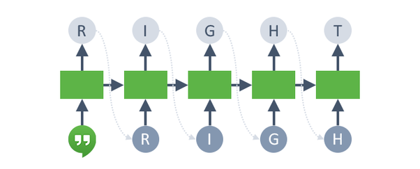{height="250"}

-   Get prediction distribution of next token

. . .

-   Generate a token from the distribution

. . .

-   Update the hidden state with new token:

## Test Time Behaviour of Generative RNN

Unlike other models we discussed so far, the training time behaviour of Generative RNNs will be **different** from the test time behaviour

Test time behaviour:

-   At each time step:
    -   Obtain a **distribution** over possible next tokens
    -   Sample a token from that distribution
    -   Update the hidden state based on the sample token

## Training Time Behaviour of Generative RNN

During training, we try to get the RNN to generate one particular sequence in the training set:

-   At each time step:
    -   Obtain a **distribution** over possible next tokens
    -   Compare this with the *actual* next token

Q1: What kind of a problem is this? (regression or classification?)

Q2: What loss function should we use during training?

## Text Generation: Step 1

{height="200"}

First classification problem:

-   Start with an initial hidden state

. . .

-   Update the hidden state with a "\<BOS\>" (beginning of string) token, so that the hidden state becomes meaningful (not just zeros)

## Text Generation: Step 1

{height="200"}

First classification problem:

-   Get the distribution over the first character

. . .

-   Compute the cross-entropy loss against the ground truth (R)

## Text Generation with Teacher Forcing

{height="200"}

Second classification problem:

-   Update the hidden state with the **ground truth** token (R) regardless of the prediction from the previous step
    -   This technique is called **teacher forcing**

## Text Generation with Teacher Forcing

{height="200"}

Second classification problem:

-   Get the distribution over the second character

. . .

-   Compute the cross-entropy loss against the ground truth (I)

## Text Generation: Later Steps

Continue until we get to the "\<EOS\>" (end of string) token

## Some Remaining Challenges

-   Vocabularies can be very large once you include people, places, etc.

. . .

-   It's computationally difficult to predict distributions over millions of words.

. . .

-   How do we deal with words we haven't seen before?

. . .

-   In some languages (e.g. German), it's hard to define what should be considered a word.

## Character vs Word-level

Another approach is to model text *one character at a time*

This solves the problem of what to do about previously unseen words.

Note that long-term memory is essential at the character level!

<!-- 02attn -->

# Recurrent Neural Networks with Attention

## Sequence-to-sequence Tasks

Another common example of a sequence-to-sequence task (seq2seq) is **machine translation**.

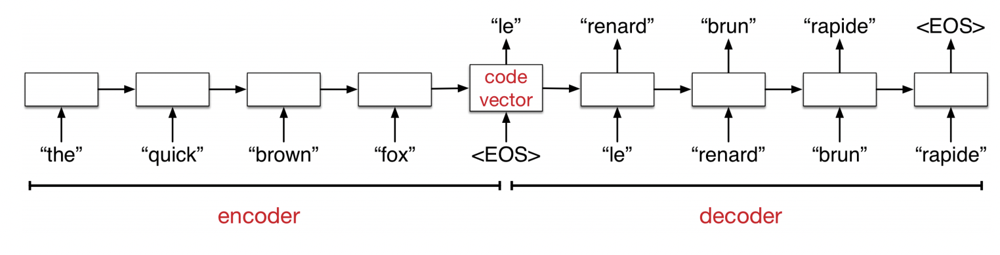{height="30%"}

The network first reads and memorizes the sentences. When it sees the "end token", it starts outputting the translation. The "encoder" and "decoder" are two different networks with different weights.

## How Seq2Seq Works

The **encoder network** reads an input sentence and stores all the information in its hidden units.

The **decoder network** then generates the output sentence one word at a time.

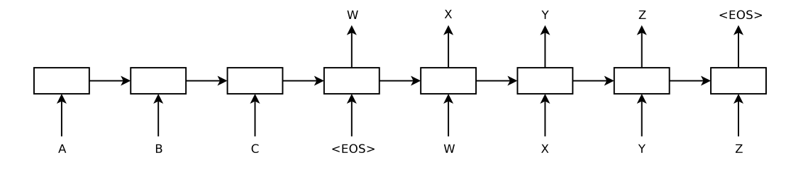{height="35%"}

## How Seq2Seq Works

{height="35%"}

But some sentences can be really long. Can we really store all the information in a vector of hidden units?

Human translators **refer back to the input**.

## Attention-Based Machine Translation

We'll look at the translation model from the classic paper:

> Bahdanau et al., Neural machine translation by jointly learning to align and translate. ICLR, 2015.

Basic idea: each **output word** comes from **one input word**, or a handful of input words. Maybe we can learn to attend to only the relevant ones as we produce the output.

We'll use the opportunity to look at architectural changes we can make to RNN models to make it even more performant.

## Encoder & Decoder Architectures

The encoder computes an **annotation** (hidden state) of each word in the input.

-   The encoder is a **bidirectional RNN**

. . .

The decoder network is also an RNN, and makes predictions one word at a time.

-   The decoder uses an **attention** mechanism (RNN with attention)

## Encoder: Bidirectional RNN

The encoder is a **bidirectional RNN**. We have two RNNs: one that runs forward and one that runs backwards. These RNNs can be LSTMs or GRUs.

The annotation of a word is the concatenation of the forward and backward hidden vectors.

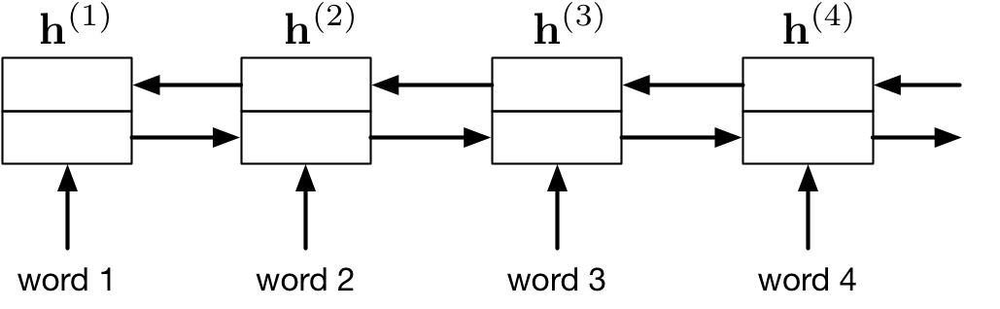{height="300"}

## Decoder: RNN with Attention

The decoder network is also an RNN, and makes predictions one word at a time.

::::: columns
::: {.column width="60%"}

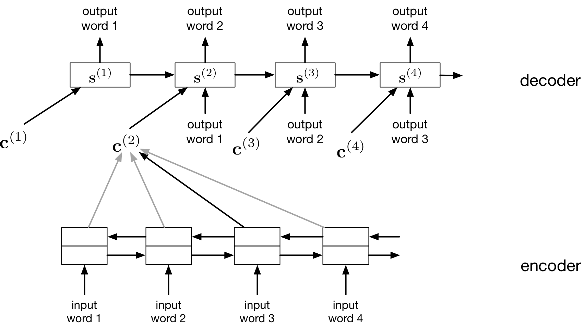

:::

::: {.column width="40%"}
The difference is that it also derives a **context vector** ${\bf c}^{(t)}$ at each time step, computed by **attending to the inputs**
:::
:::::

## Intuition Behind "Attending to the Input"

> "My language model tells me the next word should be an adjective. Find me an adjective in the input"

We would like to *refer back* to one (or a few) of the input words to help with the translation task (e.g. find the adjective)

If you were programming a translator, you might...

## Intuition Behind "Attending to the Input"

If you were programming a translator, you might

1.  find an input word that is most likely an adjective (the attention function)
2.  look up the input word that is the adjective (the weighted average)
3.  translate the input word, e.g. using the input word, and a dictionary (the projection MLP)

An attentional decoder is like a *continuous* form of these last three steps.

## The Math Behind "Attending to the Input"

-   "My language model tells me the next word should be an adjective. Find me an adjective in the input"

The context vector is computed as a **weighted average** of the encoder's annotations:

$${\bf c}^{(i)} = \sum_j \alpha_{ij} {\bf h}^{(j)}$$

## The Math Behind "Attending to the Input"

The attention weights are computed as a softmax, where the input depends on the *annotation* ${\bf h}^{(j)}$ and the *decoder states* ${\bf s}^{(t)}$:

$$
e_{ij} = a({\bf s}^{(i-1)}, {\bf h}^{(j)}), \qquad \alpha_{ij} = \frac{ \exp(e_{ij}) }{\sum_{j^\prime} \exp(e_{ij^\prime})}
$$

The attention function depends on the **annotation vector**, rather than the **position in the sentence**. It is a form of content-based addressing.

## Example: How to Obtain a Context Vector?

\begin{align*}
{\bf h}^{(1)} &= \begin{bmatrix}1 & 3 & 9\end{bmatrix}^\top \\
{\bf h}^{(2)} &= \begin{bmatrix}0 & 0 & 1\end{bmatrix}^\top \\
{\bf h}^{(3)} &= \begin{bmatrix}5 & -1 & 2\end{bmatrix}^\top \\
\\
{\bf c}^{(t)} &= \begin{bmatrix}? & ? & ?\end{bmatrix}^\top \\
\end{align*}

## Example: Average Pooling is Context Independent

\begin{align*}
{\bf h}^{(1)} &= \begin{bmatrix}1 & 3 & 9\end{bmatrix}^\top \\
{\bf h}^{(2)} &= \begin{bmatrix}0 & 0 & 1\end{bmatrix}^\top \\
{\bf h}^{(3)} &= \begin{bmatrix}5 & -1 & 2\end{bmatrix}^\top \\
\\
{\bf c}^{(t)} &= \text{average}({\bf h}^{(1)} , {\bf h}^{(2)}, {\bf h}^{(3)})\\
&= \begin{bmatrix}2 & 0.67 & 4\end{bmatrix}^\top \\
\end{align*}

## Example: Attention

\begin{align*}
{\bf h}^{(1)} &= \begin{bmatrix}1 & 3 & 9\end{bmatrix}^\top \\
{\bf h}^{(2)} &= \begin{bmatrix}0 & 0 & 1\end{bmatrix}^\top \\
{\bf h}^{(3)} &= \begin{bmatrix}5 & -1 & 2\end{bmatrix}^\top \\
\\
{\bf s}^{(t-1)} &= \begin{bmatrix}0 & 1 & 1\end{bmatrix}^\top \\
\alpha_t &= \text{softmax}\left(\begin{bmatrix}
f({\bf s}^{(t-1)}, {\bf h}^{(1)}) \\
f({\bf s}^{(t-1)}, {\bf h}^{(2)}) \\
f({\bf s}^{(t-1)}, {\bf h}^{(3)}) \\
\end{bmatrix}\right) = \begin{bmatrix}\alpha_{t1} \\ \alpha_{t2} \\ \alpha_{t3}\end{bmatrix}
\end{align*}

## Example: Dot-Product Attention

\begin{align*}
{\bf h}^{(1)} &= \begin{bmatrix}1 & 3 & 9\end{bmatrix}^\top \\
{\bf h}^{(2)} &= \begin{bmatrix}0 & 0 & 1\end{bmatrix}^\top \\
{\bf h}^{(3)} &= \begin{bmatrix}5 & -1 & 2\end{bmatrix}^\top \\
\\
{\bf s}^{(t-1)} &= \begin{bmatrix}0 & 1 & 1\end{bmatrix}^\top \\
\alpha_t &= \text{softmax}\left(\begin{bmatrix}
               {\bf s}^{(t-1)} \cdot {\bf h}^{(1)} \\
               {\bf s}^{(t-1)} \cdot {\bf h}^{(2)} \\
               {\bf s}^{(t-1)} \cdot {\bf h}^{(3)} \\
               \end{bmatrix}\right) = \begin{bmatrix}\alpha_{t1} \\ \alpha_{t2} \\ \alpha_{t3}\end{bmatrix}
\end{align*}

## Example: Dot-Product Attention

\begin{align*}
{\bf h}^{(1)} &= \begin{bmatrix}1 & 3 & 9\end{bmatrix}^\top \\
{\bf h}^{(2)} &= \begin{bmatrix}0 & 0 & 1\end{bmatrix}^\top \qquad \quad {\bf s}^{(t-1)} = \begin{bmatrix}0 & 1 & 1\end{bmatrix}^\top \\
{\bf h}^{(3)} &= \begin{bmatrix}5 & -1 & 2\end{bmatrix}^\top \\
\\
\alpha_t &= \text{softmax}\left(\begin{bmatrix}1 & 0 & 5 \\ 3 & 0 & -1 \\ 9 & 1 & 2 \end{bmatrix}^\top
                    \begin{bmatrix}0 \\ 1 \\ 1\end{bmatrix}\right) = \text{softmax}\left(\begin{bmatrix}12 \\ 1 \\ 1\end{bmatrix}\right) \\
{\bf c}^{(t)} &= \alpha_{t1} {\bf h}^{(1)} + \alpha_{t2} {\bf h}^{(2)} + \alpha_{t3} {\bf h}^{(3)}\\
\end{align*}

## Attention Demo Video

<https://play.library.utoronto.ca/watch/9ed8b3c497f82b510e9ecf441c5eef4f>

## Visualization of Attention

Visualization of the attention map (the $\alpha_{ij}$s at each time step)

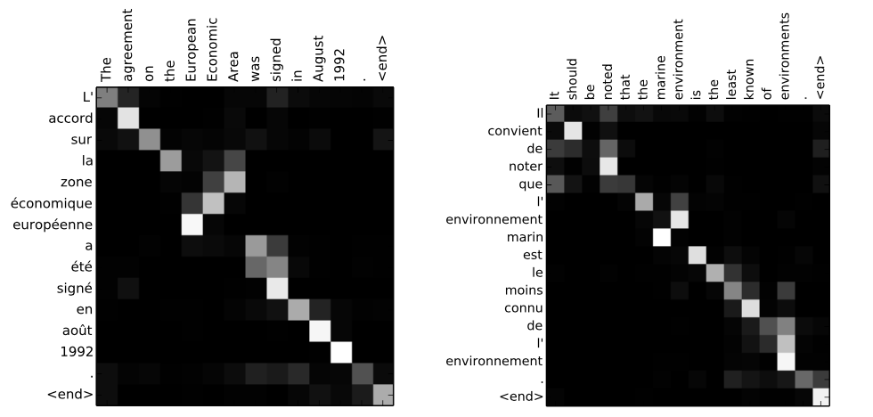{height="350"}

Nothing forces the model to go (roughly) linearly through the input sentences, but somehow it learns to do it!

## Attention Performance

The attention-based translation model does much better than the encoder/decoder model on long sentences.

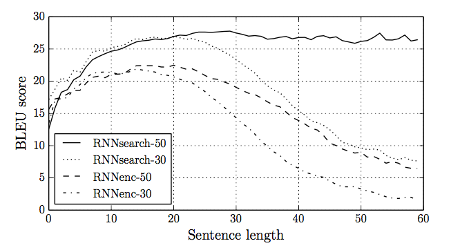{height="400"}

## Attention-Based Caption Generation

Caption Generation Task:

-   Input: Image

. . .

-   Output: Caption (sequence of words or characters)

## Attention-Based Caption Generation

Attention can also be used to understand images.

-   We humans can’t process a whole visual scene at once.

. . .

-   The fovea of the eye gives us high-acuity vision in only a tiny region of our field of view.

. . .

-   Instead, we must integrate information from a series of glimpses.

## Attention-Based Caption Generation

The next few slides are based on this paper from the UofT machine learning group:

> Xu et al. Show, Attend, and Tell: Neural Image Caption Generation with Visual Attention. ICML, 2015.

## Attention for Caption Generation

The caption generation task: take an image as input, and produce a sentence describing the image.

-   **Encoder**: a classification conv net like VGG. This computes a bunch of feature maps over the image.

## Attention for Caption Generation

-   **Decoder**: an attention-based RNN, analogous to the decoder in the translation model
    -   In each time step, the decoder computes an attention map over the entire image, effectively deciding which regions to focus on.
    -   It receives a context vector, which is the weighted average of the convnet features.

## Attention for Caption Generation

Similar math as before: difference is that $j$ is a pixel location

\begin{align*}
e_{ij} &= a({\bf s}^{(i-1)}, {\bf h}^{(j)}) \\
\alpha_{ij} &= \frac{ \exp(e_{ij}) }{\sum_{j^\prime} \exp(e_{ij^\prime})}
\end{align*}

## What Attention tells us

This lets us understand where the network is looking as it generates a sentence.

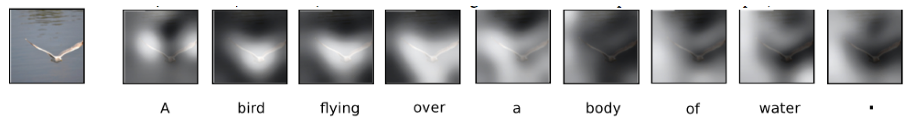

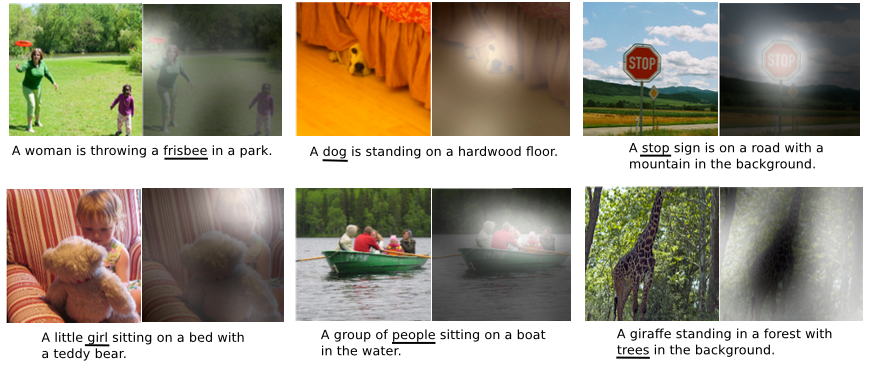{height="300"}

## What Attention tells us about mistakes

This can also help us understand the network's mistakes.

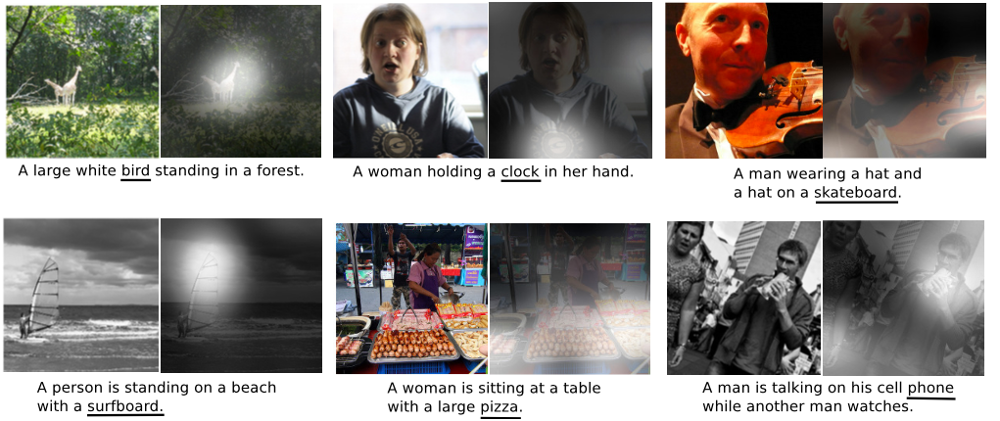

## Multi-Layer RNNs

Finally, to get more capacity/performance out of RNNs, you can **stack** multiple RNN's together!

The hidden state of your first RNN becomes the input to your second layer RNN.

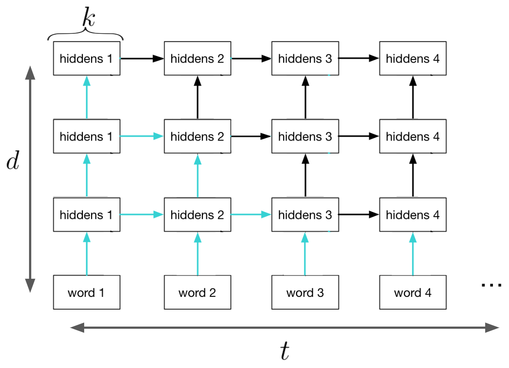{height="350"}

## RNN Disadvantage

One disadvantage of RNNs (and especially multi-layer RNNs) is that they require a long time to train, and are more difficult to parallelize. (Need the previous hidden state $h^{(t)}$ to be able to compute $h^{(t+1)}$)

<!-- 03transformer -->

# Transformer

## ChatGPT

{height="450"}

## ChatGPT

What is ChatGPT? We'll let it speak for itself:

> I am ChatGPT, a large language model developed by OpenAI. I use machine learning algorithms to generate responses to questions and statements posed to me by users. I am designed to understand and generate natural language responses in a variety of domains and topics, from general knowledge to specific technical fields. My purpose is to assist users in generating accurate and informative responses to their queries and to provide helpful insights and suggestions.

## ChatGPT

ChatGPT is built on OpenAI's GPT family of large language models (starting with GPT-3.5), all of which are based on the **transformer** architecture.

## Transformer

Idea: Do away with recurrent networks altogether; instead exclusively use attention to obtain the history at the hidden layers

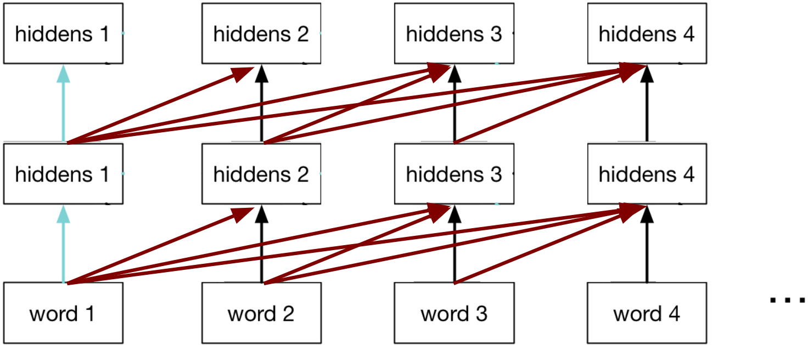{height="250"}

> Vaswani, Ashish, et al. "Attention is all you need." Advances in Neural Information Processing Systems. 2017.

## Why Get Rid of Recurrence?

Two problems with RNNs, even with attention:

-   **Sequential computation:** we need $h^{(t)}$ to compute $h^{(t+1)}$, so we cannot parallelize across time steps

. . .

-   **Long paths:** information from token $1$ has to pass through $t-1$ hidden state updates to reach token $t$, which makes long-range dependencies hard to learn

. . .

Attention already gives the decoder a *direct* connection to every encoder state. The transformer uses attention **everywhere**, including inside the encoder and the decoder.

## Vaswani, Ashish, et al. Attention is all you need.

::::: columns
::: {.column width="60%"}

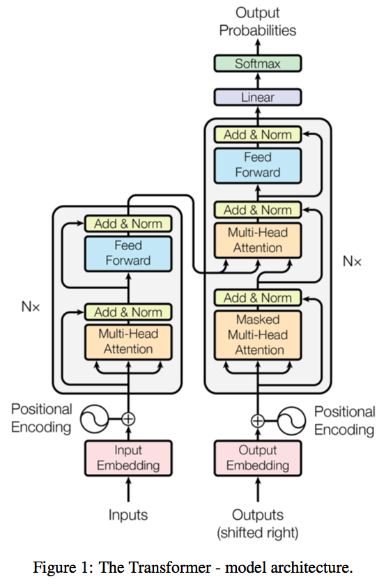{height="400"}

:::

::: {.column width="40%"}
Transformer has an encoder-decoder architecture similar to the previous sequence-to-sequence RNN models, except all the recurrent connections are replaced by attention modules.
:::
:::::

## Attention as a Soft Dictionary Lookup

A Python dictionary `d[query]`:

-   compares the **query** with every **key**, looking for an exact match
-   returns the **value** of the matching key

. . .

Attention is a "soft" version of this:

-   compares the query with every key using a similarity score (e.g. a dot product)
-   returns a **weighted average of all values**, with weights given by a softmax over the scores

$$
\alpha_j = \frac{\exp({\bf q} \cdot {\bf k}_j)}{\sum_{j'} \exp({\bf q} \cdot {\bf k}_{j'})}, \qquad {\bf c} = \sum_j \alpha_j {\bf v}_j
$$

## Bahdanau Attention as Queries, Keys and Values

In the RNN decoder with attention:

-   **Query:** the decoder state ${\bf s}^{(t-1)}$ ("what am I looking for?")
-   **Keys:** the encoder annotations ${\bf h}^{(j)}$ ("what does each input contain?")
-   **Values:** also the annotations ${\bf h}^{(j)}$ ("what do I return if this input is selected?")

## Bahdanau Attention as Queries, Keys and Values

The transformer computes queries, keys and values with separate **learned** linear maps, so keys and values can differ:

$$
{\bf q} = W^Q {\bf s}^{(t-1)}, \qquad {\bf k}_j = W^K {\bf h}^{(j)}, \qquad {\bf v}_j = W^V {\bf h}^{(j)}
$$

In the transformer there is no RNN: ${\bf h}^{(j)}$ and ${\bf s}^{(t-1)}$ are replaced by the encoder outputs and the decoder's own representations, introduced in the next slides.

## Recall: Dot-Product Attention

\begin{align*}
{\bf h}^{(1)} &= \begin{bmatrix}1 & 3 & 9\end{bmatrix}^\top \\
{\bf h}^{(2)} &= \begin{bmatrix}0 & 0 & 1\end{bmatrix}^\top \qquad \quad {\bf s}^{(t-1)} = \begin{bmatrix}0 & 1 & 1\end{bmatrix}^\top \\
{\bf h}^{(3)} &= \begin{bmatrix}5 & -1 & 2\end{bmatrix}^\top \\
\\
\alpha_t &= \text{softmax}\left(\begin{bmatrix}1 & 0 & 5 \\ 3 & 0 & -1 \\ 9 & 1 & 2 \end{bmatrix}^\top
                    \begin{bmatrix}0 \\ 1 \\ 1\end{bmatrix}\right) = \text{softmax}\left(\begin{bmatrix}12 \\ 1 \\ 1\end{bmatrix}\right) \\
{\bf c}^{(t)} &= \alpha_{t1} {\bf h}^{(1)} + \alpha_{t2} {\bf h}^{(2)} + \alpha_{t3} {\bf h}^{(3)}\\
\end{align*}

## Scaled Dot-Product Attention

\begin{align*}
{\bf h}^{(1)} &= \begin{bmatrix}1 & 3 & 9\end{bmatrix}^\top \qquad \quad {\bf h}^{(2)} = \begin{bmatrix}0 & 0 & 1\end{bmatrix}^\top \\
{\bf h}^{(3)} &= \begin{bmatrix}5 & -1 & 2\end{bmatrix}^\top \qquad \quad {\bf s}^{(t-1)} = \begin{bmatrix}0 & 1 & 1\end{bmatrix}^\top \\
\alpha_t &= \text{softmax}\left(\frac{1}{\sqrt{3}} \begin{bmatrix}1 & 0 & 5 \\ 3 & 0 & -1 \\ 9 & 1 & 2 \end{bmatrix}^\top
                    \begin{bmatrix}0 \\ 1 \\ 1\end{bmatrix}\right) \\
{\bf c}^{(t)} &= \alpha_{t1} {\bf h}^{(1)} + \alpha_{t2} {\bf h}^{(2)} + \alpha_{t3} {\bf h}^{(3)}\\
\end{align*} Q: Which values represent the Q, K, and V?

## Scaled Dot-Product Attention

-   **Query:** the decoder state ${\bf s}^{(t-1)}$
-   **Keys:** the annotations ${\bf h}^{(1)}, {\bf h}^{(2)}, {\bf h}^{(3)}$ (dot-producted with the query), so $d_K = 3$
-   **Values:** the same annotations ${\bf h}^{(1)}, {\bf h}^{(2)}, {\bf h}^{(3)}$ (averaged to get ${\bf c}^{(t)}$)

Here $W^Q = W^K = W^V = I$: keys and values are identical, as in Bahdanau attention.

. . .

\begin{align*}
\alpha_t &= \text{softmax}\left(\begin{bmatrix}6.93 & 0.58 & 0.58\end{bmatrix}\right) \approx \begin{bmatrix}0.9965 & 0.0017 & 0.0017\end{bmatrix} \\
{\bf c}^{(t)} &\approx \begin{bmatrix}1.005 & 2.988 & 8.974\end{bmatrix}^\top \approx {\bf h}^{(1)}
\end{align*}

## Scaled Dot-Product Attention in Matrix Form {.smaller .small-title}

Stack $n$ queries as the rows of $Q \in \mathbb{R}^{n \times d_K}$, $m$ keys as the rows of $K \in \mathbb{R}^{m \times d_K}$, and $m$ values as the rows of $V \in \mathbb{R}^{m \times d_V}$:

\begin{align*}
\text{Attention}(Q, K, V) &= \text{softmax}\left(\frac{QK^\top}{\sqrt{d_K}}\right) V
= \begin{bmatrix} {{\bf c}^{(1)}}^\top \\ \vdots \\ {{\bf c}^{(n)}}^\top \end{bmatrix} \\
\text{where} \quad {\bf c}^{(i)} &= \sum_{j=1}^{m} \alpha_{ij} {\bf v}_j,
\qquad
\alpha_{ij} = \frac{\exp({\bf q}_i \cdot {\bf k}_j / \sqrt{d_K})}{\sum_{j'} \exp({\bf q}_i \cdot {\bf k}_{j'} / \sqrt{d_K})}
\end{align*}

-   $QK^\top$ is an $n \times m$ matrix of scores; the softmax is applied to each row, giving the weights $\alpha_{ij}$
-   Row $i$ of the $n \times d_V$ output is the context vector ${\bf c}^{(i)} \in \mathbb{R}^{d_V}$ for query ${\bf q}_i$: the same weighted average as before, except the logits are scaled down by $\sqrt{d_K}$

## Why Scale by $\sqrt{d_K}$? {.smaller}

If the entries of ${\bf q}$ and ${\bf k}$ are independent with mean 0 and variance 1, then ${\bf q} \cdot {\bf k} = \sum_{i=1}^{d_K} q_i k_i$ has variance $d_K$.

-   Large $d_K$ means large logits, so the softmax is nearly one-hot
-   A saturated softmax has gradients close to 0
-   Dividing by $\sqrt{d_K}$ brings the variance back to 1

. . .

In our example ($d_K = 3$):

\begin{align*}
\text{unscaled:} \quad \text{softmax}\left(\begin{bmatrix}12 & 1 & 1\end{bmatrix}\right) &\approx \begin{bmatrix}0.99997 & 1.7 \times 10^{-5} & 1.7 \times 10^{-5}\end{bmatrix} \\
\text{scaled:} \quad \text{softmax}\left(\begin{bmatrix}6.93 & 0.58 & 0.58\end{bmatrix}\right) &\approx \begin{bmatrix}0.9965 & 0.0017 & 0.0017\end{bmatrix}
\end{align*}

With only $d_K = 3$ the effect is small, but in practice $d_K$ is 64 or more, and the unscaled softmax becomes essentially one-hot.

## Self-Attention {.smaller}

In the RNN, attention connected the decoder to the encoder. **Self-attention** lets a sequence attend to *itself*.

Given the inputs $X \in \mathbb{R}^{n \times d}$ (one row per token):

\begin{align*}
Q = XW^Q, \qquad K = XW^K, \qquad V = XW^V, \qquad \text{SelfAttention}(X) = \text{Attention}(Q, K, V)
\end{align*}

-   Each token's new representation is a weighted average of the (transformed) representations of *all* tokens
-   $W^Q$, $W^K$, $W^V$ are learned
-   All $n$ outputs are computed in parallel: no recurrence!
-   In the **encoder**, every token attends to every token (no mask); the decoder version comes next

## Self-Attention in the Decoder: Causal Masking {.smaller .small-title}

The decoder generates one token at a time, so position $i$ must **not** see positions $j > i$ (those are the tokens it is trying to predict!).

We add a mask $M$ to the logits before the softmax:

\begin{align*}
\text{MaskedAttention}(Q, K, V) = \text{softmax}\left(\frac{QK^\top}{\sqrt{d_K}} + M\right) V,
\qquad
M = \begin{bmatrix}
0 & -\infty & -\infty & -\infty \\
0 & 0 & -\infty & -\infty \\
0 & 0 & 0 & -\infty \\
0 & 0 & 0 & 0
\end{bmatrix}
\end{align*}

Since $\exp(-\infty) = 0$, future tokens get attention weight 0.

## Causal Masking {.smaller}

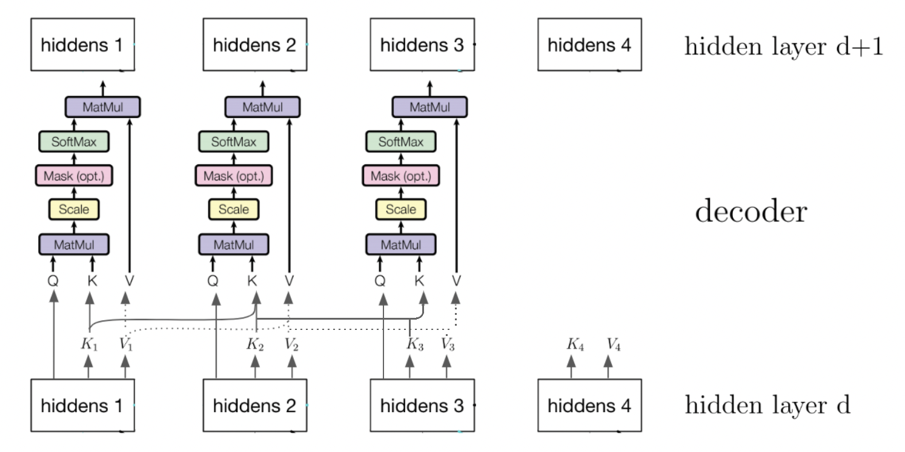{height="230"}

[Attention block adapted from Figure 2 of Vaswani et al., "Attention is all you need," NeurIPS 2017.]{style="font-size: 0.6em;"}

From the hidden vector ${\bf x}_i^{(d)}$ of position $i$ in layer $d$: $Q_i = W^Q {\bf x}_i^{(d)}$, $K_i = W^K {\bf x}_i^{(d)}$, $V_i = W^V {\bf x}_i^{(d)}$, and

$$
{\bf c}^{(i)} = \sum_{j \le i} \alpha_{ij} V_j, \qquad \alpha_{ij} = \text{softmax}_{j \le i}\left(Q_i \cdot K_j / \sqrt{d_K}\right)
$$

Since position $i$ only attends to $j \le i$, no information flows from future tokens.

## Masking and Teacher Forcing {.smaller .small-title}

Recall **teacher forcing**: during training, we feed the ground-truth previous token as the next input.

-   **RNN:** even with teacher forcing, the hidden states must be computed one step at a time

. . .

-   **Transformer decoder:** feed the whole ground-truth sequence (shifted right, starting with "\<BOS\>") at once. The causal mask ensures the prediction at position $t$ only depends on tokens before it, so *all* the next-token losses are computed in one parallel forward pass

. . .

At test time, we still generate one token at a time: sample a token, append it to the input, and repeat.

## Cross-Attention: Attending to the Encoder {.smaller .small-title}

::::: columns
::: {.column width="55%"}

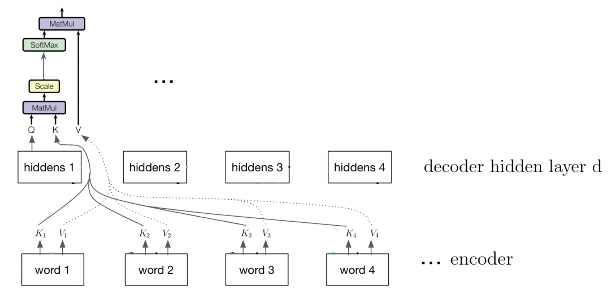{height="350"}

[Attention block adapted from Figure 2 of Vaswani et al., "Attention is all you need," NeurIPS 2017.]{style="font-size: 0.6em;"}

:::

::: {.column width="45%"}
The decoder also attends to the encoder outputs (**encoder-decoder attention** or **cross-attention**):

-   Queries come from the decoder
-   Keys and values are linear transformations of the encoder outputs

For each input word $j$, the last encoder layer outputs a vector ${\bf z}_j$, which gives that word's key ${\bf k}_j = W^K {\bf z}_j$ and value ${\bf v}_j = W^V {\bf z}_j$. The same $W^K$ and $W^V$ are shared by all words.

This is the transformer version of the Bahdanau attention we saw earlier.
:::
:::::

## Three Kinds of Attention in a Transformer

| Attention                    | Queries from | Keys and values from | Mask   |
|------------------------------|--------------|----------------------|--------|
| Encoder self-attention       | encoder      | encoder              | none   |
| Decoder self-attention       | decoder      | decoder              | causal |
| Encoder-decoder attention    | decoder      | encoder outputs      | none   |

## Multi-Headed Attention {.smaller}

A single attention head produces one weighted average, so it tends to focus on one or a few positions (one kind of relationship).

But we may want to attend to several things at once (e.g. the subject of a verb *and* its object).

**Idea:** run $h$ attention heads in parallel, each with its own learned projections:

\begin{align*}
\mathbf c_i &= \text{Attention}\left(QW_i^Q, KW_i^K, VW_i^V\right), \qquad i = 1, \dots, h \\
\text{MultiHead}(Q, K, V) &= \text{concat}({\bf c_1}, \dots, {\mathbf c_h})W^O
\end{align*}

-   Each head typically uses dimension $d_K = d_V = d_{model}/h$, so the total cost is similar to a single full-size head
-   With $n$ queries, head $i$ outputs a matrix $\mathbf c_i \in \mathbb{R}^{n \times d_V}$ (one context vector per query, as rows), so the concatenation is $n \times h d_V$
-   $W^O \in \mathbb{R}^{h d_V \times d_{model}}$ is a learned output projection: it **mixes** the heads' outputs (otherwise each head's result would sit in its own separate block of coordinates) and maps the result back to $d_{model}$, so it can be added to the residual connection and fed to the next layer

## Input Sequence Order {.smaller}

\begin{align*}
\mathbf c_i &= \text{Attention}\left(QW_i^Q, KW_i^K, VW_i^V\right) \\
\text{MultiHead}(Q, K, V) &= \text{concat}({\bf c_1}, \dots, {\mathbf c_h})W^O
\end{align*}

Unlike RNNs and CNN encoders, self-attention has no notion of position: if we shuffle the input tokens, the outputs are shuffled in the same way (the layer is *permutation-equivariant*). Can you see why?

. . .

"dog bites man" and "man bites dog" produce the same set of token representations. However, the order of the sequence conveys important information for machine translation, language modeling, and other tasks.

## Positional Encoding {.smaller}

**Idea:** Add positional information of each input token in the sequence into the input embedding vectors.

\begin{align*}
PE_{\text{pos}, 2i} &= \sin\left(\text{pos}/10000^{2i/d_{emb}}\right) \\
PE_{\text{pos}, 2i+1} &= \cos\left(\text{pos}/10000^{2i/d_{emb}}\right)
\end{align*}

-   $\text{pos} = 0, 1, 2, \dots$ is the position (index) of the token in the sequence
-   $2i$ and $2i+1$ index the dimensions of the encoding vector, $i = 0, \dots, d_{emb}/2 - 1$

Each dimension is a sinusoid with a different wavelength, from $2\pi$ to $10000 \cdot 2\pi$.

## Positional Encoding {.smaller}

The final input embedding is the **sum** of the learnable token embedding and the positional encoding (both have dimension $d_{emb}$):

$$
{\bf x}^{(\text{pos})} = \text{Emb}(w^{(\text{pos})}) + PE_{\text{pos}}
$$

where $w^{(\text{pos})}$ is the token at position $\text{pos}$ and $\text{Emb}$ is the learned embedding lookup. $\text{Emb}(w^{(\text{pos})})$ plays the role of the RNN input ${\bf x}^{(t)}$ (e.g. a GloVe embedding), **not** of the annotation ${\bf h}^{(j)}$, which is computed from all the inputs.

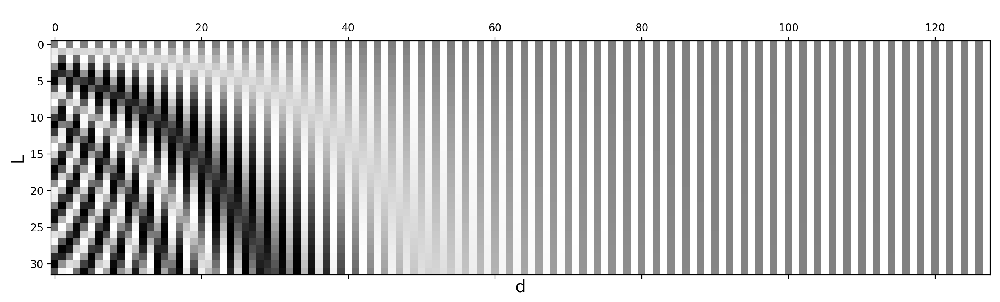{height="220"}

## Positional Encoding

Other ways to encode position used in practice:

-   **Learned positional embeddings:** one learnable vector per position (e.g. GPT-2, BERT)
-   **Rotary positional embeddings (RoPE):** rotate each query and key by a position-dependent angle, so that ${\bf q} \cdot {\bf k}$ depends only on the *relative* position of the two tokens (used by most modern LLMs, e.g. LLaMA)

## The Transformer Block: Encoder Layer {.smaller .small-title}

Encoder layer $d$ maps the token vectors ${\bf x}_1^{(d)}, \dots, {\bf x}_n^{(d)}$ (the rows of $X^{(d)}$) to ${\bf x}_1^{(d+1)}, \dots, {\bf x}_n^{(d+1)}$. The first layer gets ${\bf x}_i^{(0)} = \text{Emb}(w^{(i)}) + PE_i$.

1.  Multi-head self-attention gives one context vector per token: $[{\bf c}^{(1)}, \dots, {\bf c}^{(n)}] = \text{MultiHead}(X^{(d)}, X^{(d)}, X^{(d)})$
2.  **Add & Norm:** ${\bf a}_i = \text{LayerNorm}({\bf x}_i^{(d)} + {\bf c}^{(i)})$
3.  Position-wise feed-forward network, then **Add & Norm:** ${\bf x}_i^{(d+1)} = \text{LayerNorm}({\bf a}_i + \text{FFN}({\bf a}_i))$

where $\text{FFN}({\bf a}) = W_2\, \text{ReLU}(W_1 {\bf a} + {\bf b}_1) + {\bf b}_2$ is applied to each token independently.

-   Attention mixes information *across* tokens; the FFN processes each token *individually*
-   Residual (skip) connections (the "+" inside each Add & Norm) help gradients flow through deep stacks and preserve the positional and identity information of the inputs

## The Transformer Block: Decoder Layer {.smaller .small-title}

Decoder layer $d$ maps the output-token vectors ${\bf s}_1^{(d)}, \dots, {\bf s}_m^{(d)}$ (the rows of $S^{(d)}$) to ${\bf s}_1^{(d+1)}, \dots, {\bf s}_m^{(d+1)}$. The first layer gets the embeddings of the output tokens (shifted right, starting with "\<BOS\>") plus positional encodings. Let $Z$ be the final encoder outputs (rows ${\bf z}_j$).

1.  **Masked** multi-head self-attention: $[{\bf c}_{\text{self}}^{(1)}, \dots, {\bf c}_{\text{self}}^{(m)}] = \text{MaskedMultiHead}(S^{(d)}, S^{(d)}, S^{(d)})$, then ${\bf a}_i = \text{LayerNorm}({\bf s}_i^{(d)} + {\bf c}_{\text{self}}^{(i)})$
2.  **Cross-attention** to the encoder (queries from the decoder, keys and values from $Z$): $[{\bf c}_{\text{cross}}^{(1)}, \dots, {\bf c}_{\text{cross}}^{(m)}] = \text{MultiHead}(A, Z, Z)$ ($A$ has rows ${\bf a}_i$), then ${\bf b}_i = \text{LayerNorm}({\bf a}_i + {\bf c}_{\text{cross}}^{(i)})$
3.  Feed-forward network: ${\bf s}_i^{(d+1)} = \text{LayerNorm}({\bf b}_i + \text{FFN}({\bf b}_i))$

After the last decoder layer, a linear layer and softmax turn each ${\bf s}_i$ into a distribution over the next token.

## Transformer Machine Translation

::::: columns
::: {.column width="30%"}

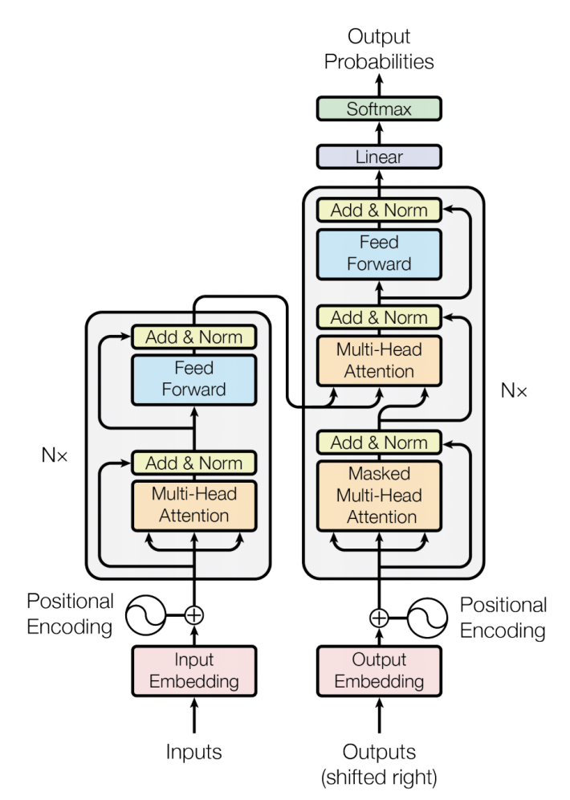

[Figure 1 of Vaswani et al., "Attention is all you need," NeurIPS 2017.]{style="font-size: 0.6em;"}

:::

::: {.column width="70%"}
-   Encoder-Decoder architecture like RNN, but use attention modules instead of recurrent modules.
-   Use $N$ stacked transformer blocks in both the encoder and the decoder ($N = 6$ in the original paper).
-   A final linear layer and softmax give the distribution over the next token.
:::
:::::

## Visualizing Attention

Self-attention layer learns that "it" could refer to different entities in different contexts.

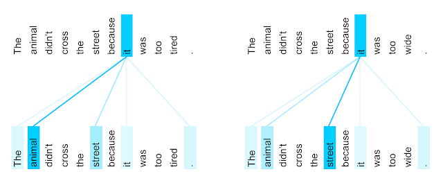{height="40%"}

See [research.google/blog/transformer-a-novel-neural-network-architecture-for-language-understanding](https://research.google/blog/transformer-a-novel-neural-network-architecture-for-language-understanding/)

## Backprop

During backprop, in the standard encoder-decoder RNN, the maximum path length across time is the number of time steps.

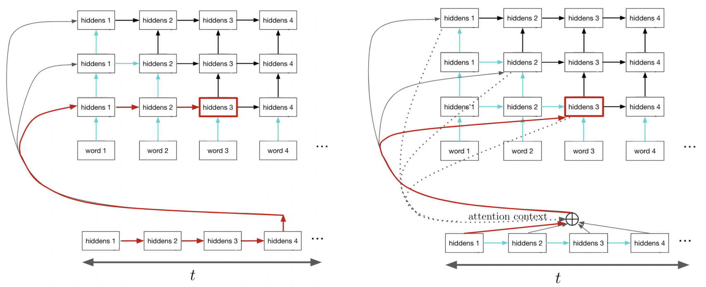{height="350"}

## Backprop

{height="350"}

Self-attention connects every position directly to every other position, so the path length between any two positions is constant. (Learning becomes easier. Why?)

## From RNN + Attention to Transformer {.smaller .small-title}

The transformer keeps the encoder-decoder structure and the decoder-to-encoder attention, but replaces the recurrence with self-attention:

| Role                              | RNN + attention                 | Transformer                                  |
|-----------------------------------|---------------------------------|----------------------------------------------|
| Encoder representations           | Bidirectional RNN               | Stack of self-attention layers               |
| Per-word encoder vector           | Annotation ${\bf h}^{(j)}$      | Encoder output ${\bf z}_j$                   |
| Decoder representations           | Decoder RNN, state ${\bf s}^{(t)}$ | Stack of masked self-attention layers, ${\bf s}_i^{(d)}$ |
| Decoder attends to encoder        | Bahdanau attention              | Cross-attention                              |
| Word order                        | Reading tokens in sequence      | Positional encoding                          |

Unchanged: teacher forcing during training, and generating one token at a time at test time.

## RNN vs. Self-Attention

For a sequence of length $n$ and representation dimension $d$:

| Layer type     | Cost per layer   | Sequential operations | Maximum path length |
|----------------|------------------|-----------------------|---------------------|
| Recurrent      | $O(n d^2)$       | $O(n)$                | $O(n)$              |
| Self-attention | $O(n^2 d)$       | $O(1)$                | $O(1)$              |

-   Self-attention wins on parallelism and path length
-   The price: the cost grows **quadratically** with the sequence length, which is why long context windows are expensive

## Transformer Language Pre-Training

Similar to pre-training computer vision models on ImageNet, we can pre-train a language model for NLP tasks.

::::: columns
::: {.column width="60%"}

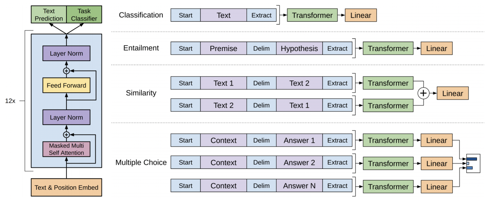{height="250"}

:::

::: {.column width="40%"}
The pre-trained model is then fine-tuned on textual entailment, question answering, semantic similarity assessment, and document classification
:::
:::::

## Decoder-Only Language Models

GPT-style models drop the encoder and the cross-attention entirely:

-   A stack of masked self-attention blocks
-   Trained on next-token prediction (with teacher forcing and causal masking) over huge text corpora
-   Generate text one token at a time, exactly like the generative RNN at the start of this lecture

## Better Language Models

<https://openai.com/blog/better-language-models/>

-   Input: Human-Written Prompt (small paragraph)

. . .

-   Output: Article about the topic (many paragraphs)

## Transformer Tutorial

[www.youtube.com/watch?v=XSSTuhyAmnI&ab_channel=AriSeff](https://www.youtube.com/watch?v=XSSTuhyAmnI&ab_channel=AriSeff)

## GPT-3: Generating an Article

\scriptsize

Title: United Methodists Agree to Historic Split

Subtitle: Those who oppose gay marriage will form their own denomination

## GPT-3: Generating an Article

Article: After two days of intense debate, the United Methodist Church has agreed to a historic split - one that is expected to end in the creation of a new denomination, one that will be "theologically and socially conservative," according to The Washington Post. The majority of delegates attending the church's annual General Conference in May voted to strengthen a ban on the ordination of LGBTQ clergy and to write new rules that will "discipline" clergy who officiate at same-sex weddings. But those who opposed these measures have a new plan: They say they will form a separate denomination by 2020, calling their church the Christian Methodist denomination.

## GPT-3: Generating an Article

The Post notes that the denomination, which claims 12.5 million members, was in the early 20th century the "largest Protestant denomination in the U.S.," but that it has been shrinking in recent decades. The new split will be the second in the church's history. The first occurred in 1968, when roughly 10 percent of the denomination left to form the Evangelical United Brethren Church.

## GPT-3: Generating an Article

The Post notes that the proposed split "comes at a critical time for the church, which has been losing members for years," which has been "pushed toward the brink of a schism over the role of LGBTQ people in the church." Gay marriage is not the only issue that has divided the church. In 2016, the denomination was split over ordination of transgender clergy, with the North Pacific regional conference voting to ban the

[Brown et al. 2020, Language Models are Few-Shot Learners](https://arxiv.org/pdf/2005.14165.pdf)

## GPT-3: Correcting English Grammar

\scriptsize

Poor English input: The patient was died.

Good English output: The patient died.

Poor English input: We think that Leslie likes ourselves.

Good English output: We think that Leslie likes us.

Poor English input: Janet broke Bill on the finger.

Good English output: Janet broke Bill's finger.

Poor English input: Mary arranged for, in St. Louis, John to rent a house cheap.

Good English output: Mary arranged for John to rent a house in St. Louis.

## GPT-3: Correcting English Grammar

Poor English input: Today I have went to the store to to buys some many bottle of water.

Good English output: Today I went to the store to buy some bottles of water.

Poor English input: I have tried to hit ball with bat, but my swing is has miss.

Good English output: I tried to hit the ball with the bat, but my swing missed.

[Brown et al. 2020, Language Models are Few-Shot Learners](https://arxiv.org/pdf/2005.14165.pdf)

## Large Language Models (LLMs)

Many Transformer-based models have been developed since 2017.

-   Generative Pre-Trained Transformer (GPT-1/2/3/4, ...)
    -   Decoder-only Transformer: GPT-1 has 12 layers and 12 heads; GPT-3 (175B parameters) has 96 layers and 96 heads.
    -   Inspired GPT-Neo, GPT-J, GPT-NeoX, LLaMA, and many others.

## Large Language Models (LLMs)

-   Bidirectional Encoder Representations from Transformers (BERT)
    -   Encoder-only 12-layer/12-headed Transformer.
    -   Inspired ALBERT, RoBERTa, SBERT, DeBERTa, etc.

## Large Language Models (LLMs)

-   And many, many more: [en.wikipedia.org/wiki/Large_language_model](https://en.wikipedia.org/wiki/Large_language_model)

Many benchmarks have been developed such as GLUE and SQuAD.

Big players in the LLM space include Google (Brain, DeepMind), Meta (formerly Facebook, FAIR), Microsoft, Amazon, Anthropic, Mistral, DeepSeek, EleutherAI, OpenAI, Cohere, Hugging Face.

## From GPT to ChatGPT

A pre-trained language model only *continues* text. To turn it into an assistant:

1.  **Instruction tuning:** fine-tune on examples of prompts paired with good responses
2.  **Reinforcement learning from human feedback (RLHF):** humans rank model responses, a reward model is trained on these rankings, and the language model is optimized with RL to get high reward

> Ouyang et al., [Training language models to follow instructions with human feedback](https://arxiv.org/abs/2203.02155). NeurIPS, 2022.

## Instruction Tuning {.smaller}

Pre-training data is mostly web text. Given the prompt "Explain the moon landing to a 6 year old", a pre-trained model may continue with more similar questions instead of answering.

**Idea:** collect **demonstrations** of the behaviour we want: a prompt ${\bf x}$, and a response ${\bf y} = (y_1, \dots, y_T)$ written by a human labeler, showing what a helpful answer looks like.

| Prompt ${\bf x}$ | Response ${\bf y}$ |
|---------------------------------|-------------------------------------------|
| Explain the moon landing to a 6 year old. | People went to the moon in a big rocket, walked around, and came back to tell everyone what they saw. |

Fine-tuning the pre-trained model on these pairs is called **instruction tuning** or **supervised fine-tuning (SFT)**.

## Instruction Tuning {.smaller}

Concatenate the prompt and the response into one token sequence, and train with the **same next-token cross-entropy** as in pre-training (teacher forcing, causal mask), but only count the loss on the response tokens:

$$
\mathcal{L}(\theta) = -\sum_{t=1}^{T} \log p_\theta\left(y_t \mid {\bf x}, y_1, \dots, y_{t-1}\right)
$$

-   Start from the pre-trained weights. The dataset is tiny compared to pre-training (about 13k prompts for InstructGPT), so this is cheap
-   The model mostly learns the *format and behaviour* of an assistant; its knowledge still comes from pre-training

. . .

**Limitation:** the model can only imitate the demonstrations, and they are slow and expensive to write. For many prompts it is much easier for a person to say which of two responses is better than to write the best response themselves. This is what RLHF uses.

## RLHF: Learning a Reward Model {.smaller}

1.  For a prompt ${\bf x}$, sample several responses from the instruction-tuned model, and have labelers **rank** them from best to worst
2.  Train a **reward model** $r_\phi({\bf x}, {\bf y}) \in \mathbb{R}$ that scores how good a response is. It is a transformer too (e.g. initialized from the language model, with the final layer replaced by a linear layer that outputs a scalar)

For every pair where labelers preferred ${\bf y}_w$ over ${\bf y}_l$, minimize

$$
\mathcal{L}(\phi) = -\log \sigma\left(r_\phi({\bf x}, {\bf y}_w) - r_\phi({\bf x}, {\bf y}_l)\right)
$$

-   This is logistic regression on the difference of the scores: the model predicts $p({\bf y}_w \text{ preferred}) = \sigma(r_w - r_l)$
-   Only differences of scores matter, which matches the data: humans give comparisons, not absolute scores
-   Ranking $K$ responses gives $\binom{K}{2}$ comparisons from one labeling task

## RLHF: Optimizing the Language Model {.smaller}

3.  Fine-tune the language model $p_\theta$ to produce responses with high reward. Starting from the instruction-tuned model $p_{\text{SFT}}$, maximize

$$
\mathbb{E}_{{\bf x},\; {\bf y} \sim p_\theta(\cdot \mid {\bf x})}\left[ r_\phi({\bf x}, {\bf y}) - \beta \log \frac{p_\theta({\bf y} \mid {\bf x})}{p_{\text{SFT}}({\bf y} \mid {\bf x})} \right]
$$

-   Sampling tokens is not differentiable, so we cannot backpropagate through it. An RL algorithm (PPO in InstructGPT) estimates the gradient from sampled responses and their rewards
-   The second term keeps the model close to $p_{\text{SFT}}$ (on average it is a KL divergence, see a later lecture). Without it, the model exploits the reward model's mistakes (*reward hacking*): text that scores high but is not actually good

. . .

**Result:** labelers preferred the outputs of the 1.3B-parameter InstructGPT over those of the 175B-parameter GPT-3 ([Ouyang et al., 2022](https://arxiv.org/abs/2203.02155)).
